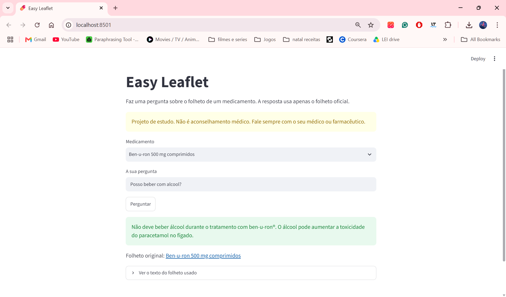
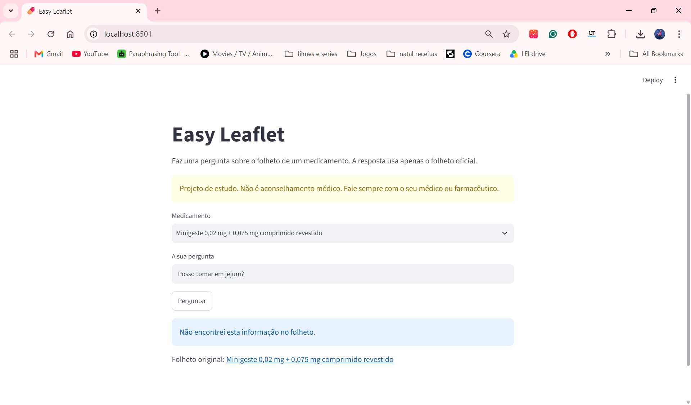
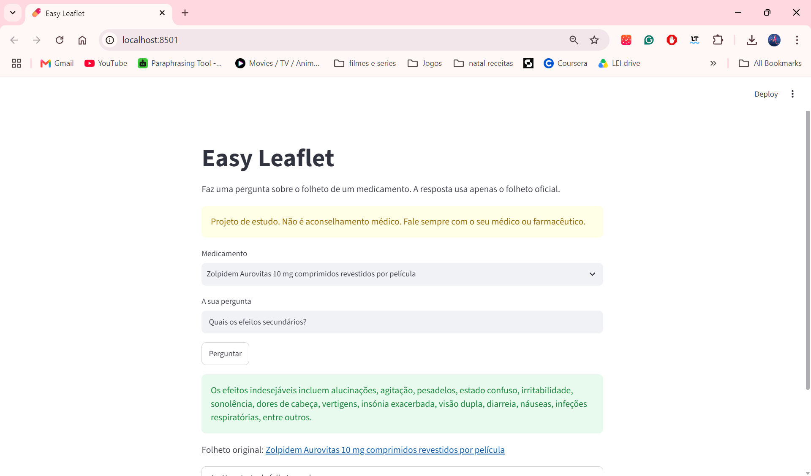

# EASY LEAFLET

Ask questions about Portuguese medicine leaflets and get a simple answer, with the original leaflet text as proof.

> **Warning:** This is a study project. It is not medical advice! Always ask your doctor or pharmacist.

**Status:** Completed. The question-answering pipeline works end to end, it is evaluated and tested, and a Streamlit demo runs on your computer (you only need a free Gemini API key).

<p align="center">
  
  
  
</p>

## Goal

Medicine leaflets are long and hard to read. This app lets a person ask a question in Portuguese (for example, "Posso tomar com álcool?") and answers using only the official leaflet. Each answer shows the part of the leaflet it used, so the person can check it.

## Data

Six official patient leaflets ("folheto informativo") of medicines sold in Portugal. Where possible they come from [Infomed](https://extranet.infarmed.pt/INFOMED-fo/), the public medicine database of Infarmed.

| Medicine | Active substance | Leaflet date | Source |
|---|---|---|---|
| Ben-u-ron 500 mg | paracetamol | 03/2026 | Manufacturer |
| Brufen 200 mg | ibuprofeno | not stated | Infomed |
| Cêgripe 500 mg + 1 mg | paracetamol + clorofenamina | 02/2025 | Infomed |
| Imodium Rapid 2 mg | loperamida | not stated | Infomed |
| Minigeste | etinilestradiol + gestodeno | 12/2021 | Manufacturer |
| Zolpidem Aurovitas 10 mg | zolpidem | 11/2021 | Third-party site |

The PDF files are not in this repository. The links are in [`data/leaflets.csv`](data/leaflets.csv). To use the project, download each PDF and save it in `data/` with the name from the `name` column (for example `data/benuron.pdf`).

Leaflets change over time. The versions used here may not be the current ones!

## Method

The app uses RAG (retrieval-augmented generation): the LLM answers from the leaflet text, not from its memory.

```
question + chosen medicine
        │
        ▼
1. Search: find the 4 most similar parts of that leaflet
        │
        ▼
2. Prompt: question + the 4 parts + rules ("use only this text")
        │
        ▼
3. LLM: answers in JSON {found, answer, excerpts}
        │
        ▼
4. Validation: check the JSON; keep only the parts the LLM really used
        │
        ▼
answer + the leaflet text that proves it
```

| Part | Choice | Why |
|---|---|---|
| PDF reading | `pdfplumber` | `pypdf` put spaces inside words in one leaflet |
| Chunks | 1000 characters, 200 overlap (about 180 chunks) | About one small topic per chunk; fits the embedding model |
| Embeddings | `intfloat/multilingual-e5-small` | Free, runs locally, understands Portuguese |
| Search | Cosine similarity, top 4, **only inside the medicine the user chose**; the medicine name is added to every chunk for the search | Without the filter, a question about alcohol returned parts of three different leaflets. The name fixes a brand-name mismatch (see [Search experiments](#search-experiments-and-why-they-stopped)) |
| LLM | Google Gemini (`gemini-3.5-flash-lite`, free tier), with timeout and 3 retries | Free; the model name is a parameter, so it is easy to change |
| Output | JSON validated with Pydantic | The app knows if the answer was found and which parts were used; broken LLM output is refused safely |
| Demo | Streamlit | A web page from one short Python file |

The link to the original leaflet is taken from `data/leaflets.csv`, never written by the LLM, so it cannot be changed by mistake.

## Evaluation

The test set is [`data/eval_questions.csv`](data/eval_questions.csv): 30 questions written from the leaflets, 5 per medicine.

- 24 questions have the answer in the leaflet. Each has the leaflet sentence that proves it, and one or more keywords that a correct answer must contain.
- 6 questions have no answer in the leaflet (price, comparisons between brands, and similar). A correct answer must say "not found".
- Questions are written like a patient would ask them, not with the leaflet's own words.

Two numbers are measured:

- **Accuracy:** the share of questions with a correct final answer.
- **Retrieval hit rate:** for answerable questions, the share where the search found the text with the answer. This shows if an error comes from the search or from the LLM.

The test set was written and checked by a person against the PDFs, not by an LLM, so the LLM is not checking its own exam.

## Results

Final setup: prompt v1, search with the medicine name in every chunk.

| Measure | Result |
|---|---|
| Accuracy | **about 87% (26 of 30)** |
| Questions with no answer in the leaflet | **100% (6 of 6)**: the app never invented an answer |
| Retrieval hit rate | 88% |

All results, question by question, are in [`results/`](results/).

### What I learned from the results

- **The first run said 53%, but that was not the real number.** 11 of 30 questions had API timeouts and were counted as wrong. I added retries and counted API errors separately; the clean run gave 87%.
- **When the app fails, it fails safely.** In the wrong answers, it says it did not find the information. It does not invent a dose.
- **Prompt v1 vs prompt v2.** Prompt v2 tried to fix the errors of v1 (apply a leaflet rule to the person's situation, list only the parts really used, shorter answers). Accuracy stayed at 87%, with no question broken. Error analysis showed why: every remaining error came from the search, not from the LLM. So the next work went to the search.

### Search experiments, and why they stopped

All errors left after prompt v2 came from the search, not from the LLM.
For two Brufen questions, the right chunk ranked 22nd of 39: the chunk says "ibuprofeno", but the question says "Brufen". Removing "Brufen" from the question moved that chunk to rank 2.

Fix: the medicine name is added to every chunk, only for the search. The retrieval hit rate went from 83% to 88%. Accuracy stayed at about 87%: the change fixed 2 questions and broke 1 (a fourth one changed because of LLM randomness, not the search).

The experiments stopped here, on purpose:

1. **The gains are now smaller than the noise.** One question is about 3 points on 30 questions, so a small real gain cannot be told apart from luck.
2. **Risk of overfitting.** Tuning the search until these 30 questions pass would make the number optimistic. A bigger test set is needed first.
3. **The remaining errors are safe.** In the failed questions the app says it did not find the answer; it does not invent one.
4. **Next ideas:** chunks that start with their section title, a bigger test set, and a search that combines keywords with embeddings.

## Tests

21 PyTest tests for the chunker, the JSON validation, the keyword check and the RAG assistant. The assistant is tested with a fake LLM and a fake search, so the tests are fast, free, need no internet and always give the same result.

```
pytest -v
```

## Limitations

- **Keyword checking is simple.** A correct answer that uses different words can be counted as wrong, and an answer can contain the keyword and still be incomplete. Wrong answers are also checked by hand.
- **Small test set.** 30 questions give a useful signal, not a precise number.
- **PDF text is messy.** Tables lose their columns and some words are joined, so questions about tables are harder.
- **Some leaflets are old** or come from non-official sites (see the Data table).
- **The demo runs locally.** It is not deployed online.

## Project structure

```
easy-leaflet/
├── app.py             Streamlit demo
├── data/              leaflets.csv, eval_questions.csv (the PDFs go here, not in Git)
├── docs/              API_KEY.md (how to get and protect the API key), images/ (screenshots)
├── results/           evaluation results (one CSV per run)
├── scripts/           ask.py, evaluate.py, compare_results.py and small investigation scripts
├── src/easy_leaflet/  Python package (loader, chunker, retriever, LLM client, prompts, schema,
│                      assistant, evaluation, pipeline)
├── tests/             PyTest tests
├── .streamlit/        Streamlit settings
├── .env.example       shows which secret the project needs
└── README.md
```

## How to run

1. Clone the repository and open the folder.
2. Create a virtual environment and install the project with the developer tools (Windows PowerShell):

   ```
   python -m venv .venv
   .venv\Scripts\Activate.ps1
   pip install -e ".[dev]"
   ```

3. Download the leaflet PDFs listed in [`data/leaflets.csv`](data/leaflets.csv) and save them in `data/` with the names from the `name` column.
4. Create a free Gemini API key in [Google AI Studio](https://aistudio.google.com/api-keys). No credit card is needed.
5. Copy `.env.example` to a new file called `.env` and paste your key in it. The full guide, with the free limits and the safety rules, is in [`docs/API_KEY.md`](docs/API_KEY.md).
6. Run the Streamlit demo (it opens in your browser):

   ```
   streamlit run app.py
   ```

7. Or ask a few questions in the terminal:

   ```
   python scripts\ask.py
   ```

8. Run the evaluation with the final setup (about 3 minutes):

   ```
   python scripts\evaluate.py v1 titles
   ```

9. Run the tests:

   ```
   pytest -v
   ```

The first run downloads the embedding model (about 470 MB) once.

## License

MIT
